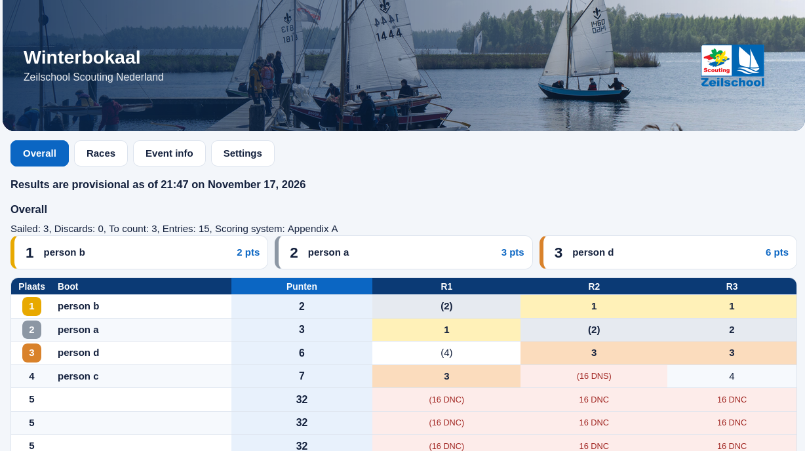

# sailwave-crisp-style

A crisp Sailwave style with settings that can be changed by the user.

## Usage

Copy the files in `files/style` and `files/template` to their respective Sailwave user folders.
The template will appear in the `Publish` dropdown menu (Crisp Results) and the style will appear in the `Style` dropdown menu (crisp-Results).

## Developer settings
You might want to change the following in the code:
- banner url
